<div align="center">
  

  <br/>

  
</div>

---

## Sobre mim

Sou **desenvolvedor front-end** em nível avançado, com um pé no código e outro nos gráficos em tempo real. Gosto de pegar uma ideia visual e transformar em algo que roda liso no navegador: de uma landing page com scroll suave e animações bem coreografadas até cenas 3D com shaders escritos na mão.

Minha especialidade são as **linguagens de shader**. Escrevo **GLSL** para WebGL e **WGSL** para a nova geração de gráficos com **WebGPU**, criando efeitos, materiais, pós-processamento e visuais procedurais que deixam uma interface com cara própria.

```ts
const cauã = {
  role: "Front-end Developer",
  specialty: ["GLSL", "WGSL", "WebGL", "WebGPU"],
  stack: ["TypeScript", "React", "Next.js", "Tailwind CSS", "Three.js"],
  motion: ["Lenis", "Anime.js", "GSAP"],
  focus: "interfaces que parecem vivas, sem abrir mão da performance",
};
```

### O que eu faço

| | |
|---|---|
| **Shaders e gráficos** | Efeitos visuais, materiais e pós-processamento em GLSL e WGSL |
| **Experiências 3D** | Cenas interativas na web com Three.js |
| **Interfaces** | Aplicações modernas e responsivas com React, Next.js e Tailwind |
| **Motion** | Scroll suave, transições e microinterações que dão vida à página |
| **Performance** | Código tipado, componentes reutilizáveis e renderização eficiente |

---

## Linguagens

<p align="center">
  
  
  
  
  
  
</p>

## Frameworks e estilo

<p align="center">
  
</p>


## Gráficos, 3D e animação

<p align="center">
  
  
  
  
  
  
</p>

## Ferramentas

<p align="center">
  
</p>

---

## Atividade

<div align="center">
  

</div>

---

<div align="center">
  
  <br/><br/>
  
</div>
